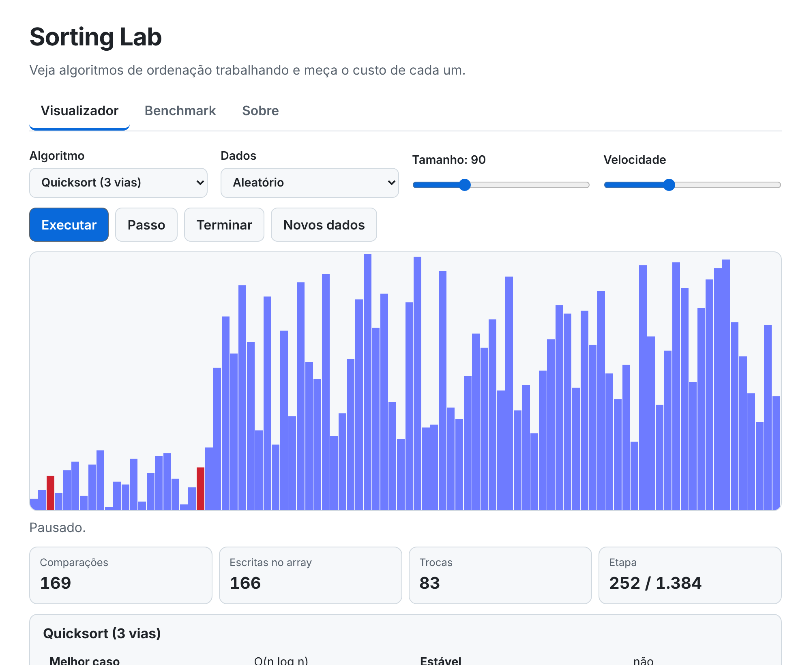
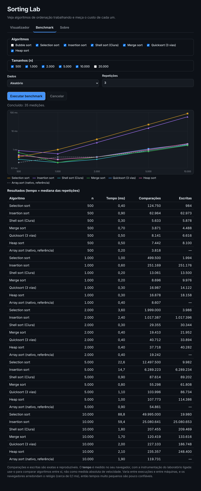

# Sorting Lab

[](https://github.com/Rimuro-Sama/SortingLab-/actions/workflows/ci.yml)

Visualizador e benchmark de algoritmos de ordenação, em **JavaScript puro** (sem framework, sem etapa de build). Dá para **ver** cada algoritmo trabalhando, **comparar o custo** em diferentes tipos de entrada e ordenar **textos em português**.

O projeto nasceu de um trabalho de faculdade em Java que ordenava 150 mil nomes ([OrdenacoesNomes-Java](https://github.com/Rimuro-Sama/OrdenacoesNomes-Java)) e ganhou uma interface.

<picture>
  <source media="(prefers-color-scheme: dark)" srcset="docs/img/visualizador-dark.png">
  
</picture>

## O que faz

**Visualizador**
- 7 algoritmos: bubble, selection, insertion, Shell (gaps de Ciura), merge, quicksort (3 vias) e heap sort.
- Executar, pausar, avançar **um passo**, terminar de uma vez e gerar novos dados.
- Entradas: aleatória, já ordenada, ordem inversa, quase ordenada e poucos valores distintos.
- Contadores ao vivo de comparações, escritas e trocas, e a complexidade teórica de cada algoritmo (melhor, médio e pior caso, estabilidade, espaço extra).

**Benchmark** (roda num Web Worker, sem travar a página)
- Escolha algoritmos, tamanhos (500 a 20.000), tipo de dado e repetições.
- Tabela com tempo (mediana), comparações e escritas, mais um gráfico em escala logarítmica.
- Inclui `Array.prototype.sort` do navegador como referência.
- Modo **nomes fictícios** (texto), ordenado com `Intl.Collator('pt-BR')`: com a comparação simples do JavaScript, "Álvaro" iria para depois de "Zélia".



## Como rodar

Requer Node 22 ou superior só para o servidor local e os testes; o site em si roda em qualquer navegador moderno.

```bash
npm run serve        # abre em http://localhost:8080
```

Os módulos ES e o Web Worker não carregam abrindo o `index.html` com duplo clique (`file://`), por isso o servidor. Com **GitHub Pages** (Settings → Pages → branch `main`, pasta `/ (root)`) funciona direto.

## Testes

```bash
npm test             # 52 testes unitários do núcleo (algoritmos e geração de dados)
npx playwright install chromium   # uma vez
npm run e2e          # 8 testes de ponta a ponta no Chromium, usando a interface de verdade
```

O que os testes garantem:
- **Cada algoritmo** ordena igual a `Array.prototype.sort` em 6 tipos de entrada, tamanhos de 0 a 1.000 e 3 sementes.
- **Estabilidade** dos algoritmos que a prometem (bubble, insertion, merge), com muitos empates.
- **Custo**: `selection` faz exatamente n(n−1)/2 comparações; `merge` e `heap` ficam dentro de seus limites teóricos; `insertion` no pior caso faz n(n−1)/2; o quicksort cresce como n·log n, não como n².
- **Reproduzir os eventos gravados** leva ao mesmo array final, e os contadores batem com os eventos.
- **Na interface**: os números mostrados na tela são *exatamente* os que o núcleo calcula para os mesmos dados; a tabela do benchmark traz contagens exatas; as abas funcionam por teclado; o servidor de desenvolvimento não serve arquivos fora da pasta do projeto.

### Um defeito que o próprio teste achou

A primeira versão do quicksort usava a mediana de três (início, meio e fim) como pivô. Ele ordenava certo e passava nos testes de correção, mas em entradas ordenadas o custo crescia mais rápido que n·log n: a razão *comparações ÷ (n·log₂ n)* subia de **3,9** (n = 1.000) para **8,5** (n = 10.000) e **20,6** (n = 100.000). Num algoritmo O(n log n) essa razão fica quase constante.

A causa: a partição em 3 vias embaralha a metade direita e a mediana fixa passa a escolher pivôs ruins. A correção foi sortear as três posições da mediana (com semente fixa, para continuar reproduzível). Agora a razão fica em **~1,7 a 1,8** em todos os tamanhos e tipos de entrada, e há um teste que falha se a deriva voltar.

## Como foi feito

Cada algoritmo é escrito **uma única vez**, como `sort(a, io)`. Toda comparação e toda escrita passam por um objeto `io` que conta as operações e, opcionalmente, grava cada uma como evento. Assim:

- o **visualizador** roda o algoritmo uma vez, grava os eventos e depois os reproduz no canvas, no ritmo escolhido;
- o **benchmark** usa o mesmo código, só contando;
- os **testes** exercitam exatamente o que o usuário vê, sem uma segunda implementação que poderia divergir.

Os dados vêm de um gerador com **semente** (mulberry32): a mesma semente gera sempre o mesmo array, então a comparação entre algoritmos é justa e qualquer resultado pode ser reproduzido.

```
js/algorithms.js        os 7 algoritmos, o objeto io e as funções de execução e reprodução
js/data.js              geradores de dados com semente e comparador pt-BR
js/visualizer.js        reprodução dos eventos no canvas
js/benchmark.js         interface do benchmark, tabela e gráfico
js/benchmark.worker.js  execução das medições no Worker
test/                   testes unitários (node:test)
e2e/                    testes de ponta a ponta (Playwright)
scripts/                servidor local e gerador dos prints deste README
```

## Resultados de exemplo

Uma execução real do benchmark (Chromium em Linux, dados aleatórios, n = 10.000, mediana de 3 repetições):

| Algoritmo | Tempo (ms) | Comparações | Escritas |
|---|---:|---:|---:|
| Selection sort | 88,8 | 49.995.000 | 19.980 |
| Insertion sort | 59,4 | 25.080.641 | 25.080.653 |
| Shell sort (Ciura) | 1,80 | 207.455 | 209.469 |
| Merge sort | 1,70 | 120.419 | 133.616 |
| Quicksort (3 vias) | 2,00 | 227.103 | 186.748 |
| Heap sort | 2,10 | 235.357 | 248.400 |
| `Array.sort` (nativo, referência) | 1,90 | 119.731 | — |

A leitura que importa: os algoritmos O(n²) (selection e insertion) fazem **dezenas de milhões** de comparações e levam dezenas de vezes mais tempo que os O(n log n), que ficam na casa das centenas de milhares. O selection sort faz o mesmo número de comparações em qualquer entrada (n(n−1)/2); o insertion sort é muito mais rápido em dados já quase ordenados.

## Limites e o que foi verificado

**Verificado, rodando de verdade:**
- Os 52 testes unitários e os 8 de ponta a ponta passam, localmente e no GitHub Actions (os dois jobs do CI, inclusive o que instala o Chromium).
- Os testes detectam regressões: quebrei de propósito a contagem de escritas na interface e o teste de ponta a ponta falhou; o teste de custo do quicksort pegou o defeito descrito acima.

**Limites:**
- **Tempo em JavaScript é impreciso.** Depende do navegador, da máquina e do aquecimento do motor. Os navegadores arredondam o relógio (o timer aqui tem resolução de ~0,1 ms), então tempos de poucos décimos de milissegundo são pouco confiáveis. Comparações e escritas são exatas; use-as junto com o tempo. O tempo mede o código **com a instrumentação ligada**, serve para comparar algoritmos entre si e não como velocidade absoluta.
- Os algoritmos O(n²) ficam muito lentos acima de ~20.000 elementos (há aviso na tela e botão de cancelar).
- `Array.sort` nativo é só referência: roda código nativo, sem a instrumentação.
- "Escritas" contam só o array principal. As cópias para o buffer auxiliar do merge sort não entram na conta.
- Testado apenas no **Chromium** (Linux). Não testei Firefox, Safari nem celulares, e a acessibilidade foi verificada por teclado nas abas, não com leitor de tela.

## Licença

[MIT](LICENSE): você pode usar, copiar e modificar este código, inclusive em projetos comerciais, mantendo o aviso de copyright. O código é fornecido sem garantia.

## Sobre o desenvolvimento

Projeto pessoal de estudo, feito por mim com apoio do Claude Code para código, testes e revisão. Eu defini o escopo; os testes e as medições foram executados de verdade e os resultados acima são desses testes.
